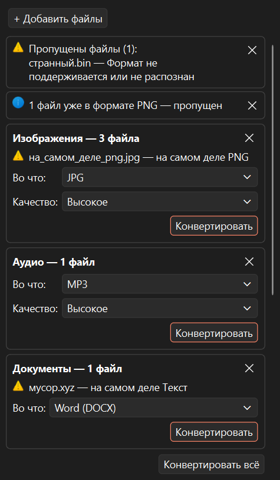
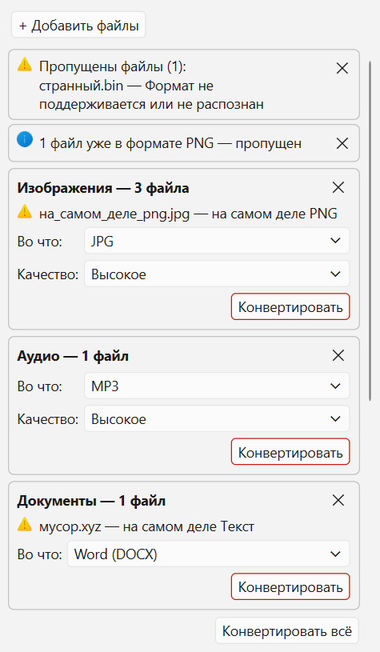
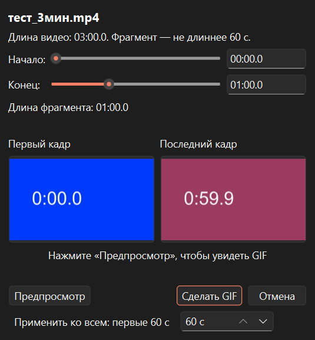

# Peregon — конвертер файлов для Windows

Peregon переводит файлы из одного формата в другой прямо на вашем компьютере: картинки, видео,
звук, PDF, документы, таблицы, презентации и электронные книги. Файлы никуда не отправляются,
интернет для работы не нужен. Программу не нужно устанавливать — это обычная папка: распаковали
и запустили.

<p>
  
  
</p>
<p>
  
</p>

## Как скачать и запустить

1. Откройте страницу **Releases** этого репозитория и скачайте архив `Peregon-<версия>-win64.zip`.
2. Распакуйте архив в любую папку, куда у вас есть право записи (например, `Документы` или флешку).
   Не кладите программу в `C:\Program Files` — оттуда она не сможет сохранять настройки
   и скачивать модуль LibreOffice (об этом она сама предупредит).
3. Запустите `Peregon.exe` из папки `Peregon`.

**Предупреждение Windows SmartScreen.** Программа не подписана платным сертификатом, поэтому при первом
запуске Windows может показать окно «Windows защитил ваш компьютер». Нажмите **«Подробнее»**, затем
**«Выполнить в любом случае»**. Если сомневаетесь — соберите программу сами из исходного кода
(см. ниже).

### Системные требования

- Windows 10 или Windows 11, 64-битная (x64).
- Около 280 МБ на диске для самой программы (архив — около 110 МБ); ещё около 1,5 ГБ — если понадобится модуль LibreOffice.

## Как пользоваться

Перетащите в окно один или несколько файлов (или папку — будут взяты файлы из неё без вложенных папок).
Ещё можно нажать «Добавить файлы» (Ctrl+O) или вставить скопированные файлы (Ctrl+V).
Выберите, во что конвертировать, и нажмите «Конвертировать». Результат появится **рядом с исходным
файлом**; исходный файл не изменяется, существующие файлы не перезаписываются — если имя занято,
получится `имя (1).ext`.

## Возможности

- **Формат определяется по содержимому**, а не по расширению. Если `фото.jpg` на самом деле PNG,
  программа так и напишет.
- **Группы.** Брошенные вместе файлы раскладываются по видам (изображения, видео, аудио…), и для
  каждой группы выбирается свой формат. Показываются только те варианты, которые имеют смысл.
- **Три пресета качества:** «Высокое», «Среднее» (по умолчанию) и «Маленький размер».
- **Очередь.** Конвертация идёт в фоне, окно не зависает; пока она идёт, можно бросать новые файлы.
- **Прогресс и отмена.** У долгих задач (видео, звук, большие PDF, офисные документы) видны проценты
  и кнопка «Отмена»; недописанный файл при отмене удаляется.
- **GIF из фрагмента видео.** Можно выбрать начало и конец (до 60 секунд), посмотреть первый
  и последний кадр и предпросмотр.
- **«Показать в папке»** — открывает Проводник с готовым файлом.
- **Офисные форматы через LibreOffice по требованию** (см. ниже).
- Окно небольшое, появляется в правом нижнем углу поверх других окон; его можно перетащить,
  положение запоминается. Оформление следует светлой или тёмной теме Windows.

## Какие форматы поддерживаются

| Что | Из каких форматов | Во что |
|---|---|---|
| Изображения | JPG, PNG, WEBP, HEIC, AVIF, GIF, BMP, TIFF, ICO, SVG, RAW фотокамер (CR2, CR3, NEF, ARW, DNG, ORF, RW2, RAF и др.) | JPG, PNG, WEBP, AVIF, GIF, BMP, TIFF, ICO, PDF (отдельный на каждое изображение или все в один) |
| Видео | MP4, MOV, MKV, AVI, WEBM, WMV, FLV, 3GP, MTS | MP4, MKV, WEBM, MOV, AVI, GIF, только звук (MP3 или WAV) |
| Аудио | MP3, WAV, FLAC, AAC, M4A, OGG, OPUS, WMA, AMR | MP3, WAV, FLAC, M4A (AAC), OGG (Vorbis), OPUS |
| PDF | PDF | страницы в PNG или JPG, текст (TXT), объединить несколько PDF в один, разделить на страницы |
| Документы | TXT, HTML, MD | DOCX, PDF, HTML, MD, TXT |
| | DOCX | HTML, MD, TXT; PDF — через LibreOffice |
| | DOC, ODT, RTF | DOCX, PDF — через LibreOffice |
| Таблицы | CSV | XLSX |
| | XLSX | CSV (первый лист или каждый лист отдельным файлом); PDF — через LibreOffice |
| | XLS, ODS | XLSX, CSV, PDF — через LibreOffice |
| Презентации | PPTX, PPT, ODP | PDF, слайды в PNG — через LibreOffice |
| Электронные книги | EPUB, FB2, MOBI (без DRM) | EPUB, FB2, PDF, TXT |

Архивы (ZIP, 7Z, RAR и т. п.) не поддерживаются: программа их узнаёт, но не распаковывает и не создаёт.

## LibreOffice по требованию

Для старых и «тяжёлых» офисных форматов (DOC, ODT, RTF, XLS, ODS, презентации, а также DOCX и XLSX
в PDF) нужен модуль LibreOffice. Он **не входит** в архив программы. Когда такая конвертация
понадобится впервые, Peregon спросит разрешения скачать его (около 375 МБ, на диске около 1,5 ГБ).
Скачивание идёт только с официального сервера The Document Foundation, подлинность проверяется
по цифровым подписям, модуль кладётся в папку программы (`data\modules`) — в систему ничего
не устанавливается. Если отказаться, остальное продолжит работать.

LibreOffice распространяется под лицензией MPL-2.0. «LibreOffice» — товарный знак The Document
Foundation; Peregon с этой организацией не связан.

## Приватность

- Всё выполняется на вашем компьютере. Программа не отправляет файлы, статистику или отчёты об ошибках.
- Сеть используется **только** для скачивания модуля LibreOffice и **только** после вашего согласия.
- Все данные программы — настройки, журнал работы, временные файлы, модуль LibreOffice — хранятся
  в папке `data` рядом с `Peregon.exe`. Программа сама не пишет в реестр, не ставит службы
  и автозагрузку. Вне папки остаются только следы, которые оставляет сама Windows с любой программой:
  кэш названий запущенных exe (MuiCache) и история стандартного окна выбора файлов.
  Значок в области уведомлений появляется лишь на несколько секунд — на время уведомления о готовности.
  Если папка программы недоступна для записи, предпросмотр GIF временно создаётся в системной папке
  временных файлов и сразу удаляется.

## Как удалить

Закройте программу и удалите папку `Peregon` целиком. Больше ничего делать не нужно.

## Известные ограничения

- Программа не подписана сертификатом — отсюда предупреждение SmartScreen при первом запуске.
- Проверено на Windows 11; запуск на «чистой» Windows без установленного Microsoft Visual C++
  Redistributable пока не проверялся.
- Нет тонких настроек (битрейт, разрешение, кодек) — только три пресета качества. Нет редактирования
  файлов (обрезки, поворота), кроме выбора фрагмента для GIF, объединения и разделения PDF.
- Нет распознавания текста (OCR) в отсканированных PDF.
- При объединении и разделении PDF теряются закладки и интерактивные формы.
- В PDF из текста и книг не попадают иероглифы и эмодзи; таблицы переносятся строками; сноски
  и оформление (CSS) книг не переносятся.
- Кодировки KOI8-R и CP866 в текстовых файлах могут определиться как Windows-1251.
- FLAC и WAV сохраняются в 16 бит; при копировании видео HEVC без перекодирования теряются
  HDR-метаданные.
- Изображения больше 200 мегапикселей не обрабатываются (защита от «бомб» и нехватки памяти).
- Очень сложные SVG могут обрабатываться до 2 минут, после чего задача прерывается.
- Разбор SVG, RAW, видео и аудио, PDF, документов и офисных файлов идёт в отдельных процессах.
  Это сделано **ради надёжности** (сбой разбора
  не роняет программу), а **не как граница безопасности**: отдельный процесс не является «песочницей».
- Нет автообновления: новые версии скачивайте вручную со страницы Releases. Нет установщика — только
  портативная папка. Работает только в Windows.

## Сборка из исходного кода

Нужны Windows 10/11 x64 и [uv](https://docs.astral.sh/uv/). Python 3.13 uv скачает сам,
все версии библиотек зафиксированы в `uv.lock`.

```powershell
git clone https://github.com/IIDOCII/Peregon.git
cd <папка репозитория>
uv sync                                   # создаёт .venv и ставит зависимости (включая инструменты разработки)
uv run python -m konverter                # запуск из исходников
uv run python packaging/build.py          # сборка: dist/Peregon/ и dist/Peregon-<версия>-win64.zip
```

Сборка выполняется PyInstaller в режиме «папка» (onedir); в папку программы и в zip автоматически
кладутся `LICENSE`, `THIRD_PARTY_LICENSES.md` и `licenses/`.

### Тесты

```powershell
$env:PYTHONIOENCODING = "utf-8"
uv run pytest -q
```

Тест с настоящими RAW-снимками использует образцы, которые не хранятся в репозитории
(`tests/data/*.cr2`, `*.cr3`); без них он пропускается.

## Лицензия

Peregon — свободная программа, распространяется под лицензией **GNU GPL версии 3 или любой более
поздней** (GPL-3.0-or-later), полный текст — в [LICENSE](LICENSE). Программа предоставляется
«как есть», без каких-либо гарантий.

Программа использует сторонние библиотеки: Qt и PySide6, FFmpeg (через PyAV) с кодеками x264, x265 и др.,
Pillow, pillow-heif (libheif, libde265), LibRaw (rawpy), resvg, PDFium (pypdfium2), qpdf (pikepdf),
fpdf2, Magika и ONNX Runtime, lxml, openpyxl, python-docx и другие. Спасибо их авторам! Полный перечень
с версиями, лицензиями, ссылками на исходный код, письменным предложением исходников и порядком замены
библиотек Qt — в [THIRD_PARTY_LICENSES.md](THIRD_PARTY_LICENSES.md), тексты лицензий — в папке
[licenses](licenses/).

## Автор

XClassiK
